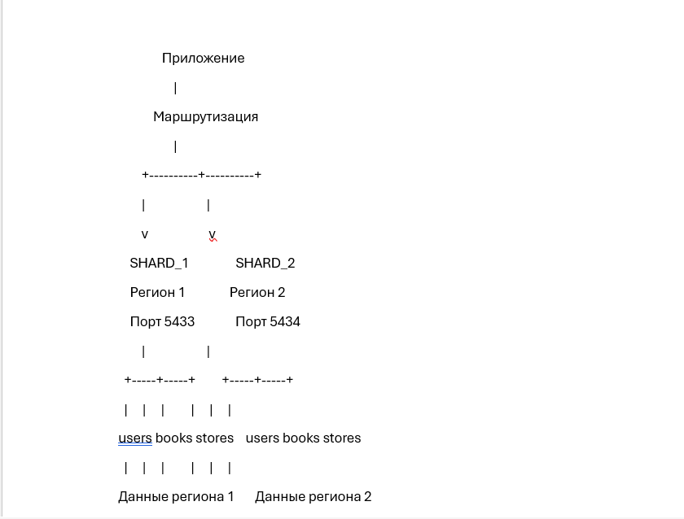
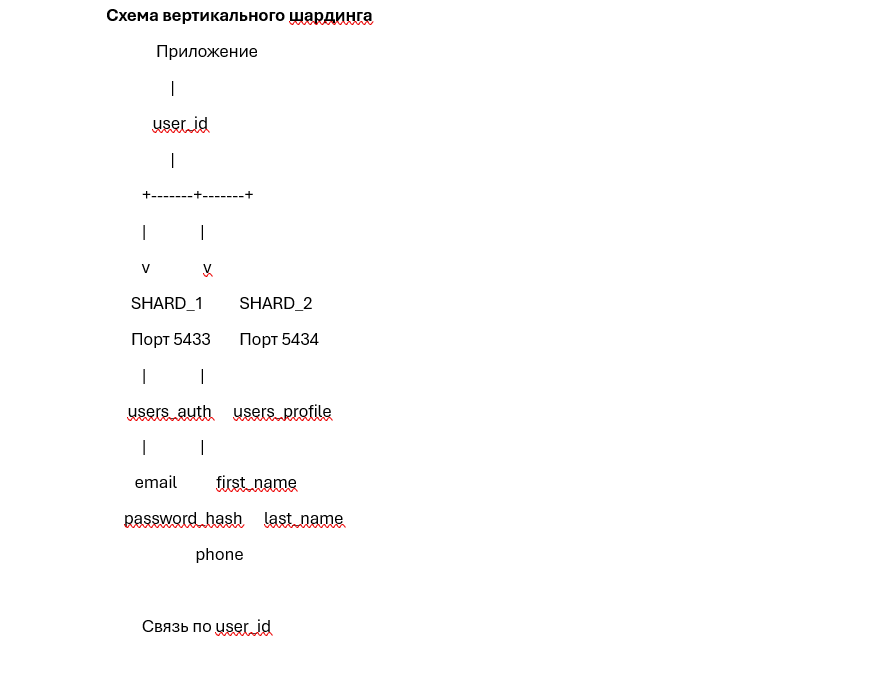

# SQL_part2 
Домашнее задание к занятию «SQL: Репликация и масштабирование. Часть 2» Dunaevskaya Olga

 # Задание 1
  1.1. Архитектура Master — Slave
В данной архитектуре используется один основной сервер Master и один резервный сервер Slave.
Master принимает операции чтения и записи, а изменения данных передаются на Slave посредством репликации.
Slave получает копию данных основного сервера и находится в режиме ожидания. При отказе Master резервный сервер может быть переведён в основной режим.
Преимущества:
1.	Повышение надёжности хранения данных благодаря наличию резервной копии.
2.	Возможность восстановления работы системы при отказе основного сервера.
3.	Упрощение резервирования и обслуживания базы данных.
4.	Возможность использовать Slave для отдельных операций чтения, если это предусмотрено архитектурой.
Недостатки:
1.	Основная нагрузка на запись остаётся на Master.
2.	При асинхронной репликации возможна потеря последних транзакций при аварии Master.
3.	Для переключения на резервный сервер необходим механизм обнаружения отказа и promotion.
4.	Один резервный сервер не обеспечивает распределения нагрузки записи.
  1.2. Архитектура Master — несколько Slave
В этой архитектуре один сервер Master передаёт изменения нескольким серверам Slave.
Master принимает операции записи, а Slave получают обновления посредством репликации. Запросы чтения можно распределять между несколькими репликами.
Преимущества:
1.	Распределение нагрузки чтения между несколькими серверами.
2.	Увеличение пропускной способности системы при большом количестве запросов.
3.	Наличие нескольких резервных копий базы данных.
4.	Возможность выделить отдельные реплики для аналитики и отчётности.
5.	Повышение доступности данных при отказе одного из Slave.
Недостатки:
1.	Увеличение сложности администрирования.
2.	Необходимость контролировать задержки репликации.
3.	Все операции записи по-прежнему проходят через Master.
4.	Требуется механизм выбора нового Master при его отказе.

 # Задание 2
  Для проектирования выбрана условная информационная система книжной сети, содержащая три основные таблицы:
пользователи;
книги;
магазины.
  В качестве СУБД используется PostgreSQL.
2.1. Структура исходных таблиц:
# Таблица users — пользователи
1.Поле	       Тип	    Назначение
2.user_id	    INTEGER	Идентификатор пользователя
3.first_name	 VARCHAR(50)	Имя
4.email	      VARCHAR(100)	Электронная почта
5.region_id	  INTEGER	Регион пользователя
# Таблица books — книги
1.Поле	      Тип	Назначение
2.book_id	    INTEGER	Идентификатор книги
3.title	      VARCHAR(150)	Название
4.author	     VARCHAR(100)	Автор
5.region_id	  INTEGER	Регион размещения
# Таблица stores — магазины
Поле	         Тип	Назначение
1.store_id	   INTEGER	Идентификатор магазина
2.store_name	 VARCHAR(100)	Название магазина
3.address	    VARCHAR(200)	Адрес
4.region_id	  INTEGER	Регион магазина
  2.2. Горизонтальный шардинг
Горизонтальный шардинг предполагает разделение таблицы на части по строкам. Каждый сервер хранит записи, относящиеся к определённому региону.
Для распределения выбран атрибут region_id.
Принцип распределения:
•	region_id = 1 — первый сервер;
•	region_id = 2 — второй сервер.
На каждом сервере создаются одинаковые таблицы users, books и stores, но содержимое таблиц различается.

В данной архитектуре приложение должно определять регион записи и направлять запрос на соответствующий сервер.
Преимущества:
•	распределение объёма данных между серверами;
•	уменьшение нагрузки на отдельный сервер;
•	возможность независимо масштабировать отдельные шарды;
•	локализация данных по регионам.
Недостатки:
•	требуется механизм маршрутизации запросов;
•	сложнее выполнять запросы, объединяющие данные разных регионов;
•	необходимо контролировать равномерность распределения данных;
•	требуется учитывать уникальность идентификаторов между шардами.

2.3. Вертикальный шардинг
Вертикальный шардинг предполагает разделение данных по столбцам или функциональным группам.
Пользовательские данные будут разделены на две части:
1.Сервер SHARD_1 — авторизационные данные
# Таблица users_auth:
Поле	           Тип	Назначение
1.user_id	      INTEGER	Идентификатор пользователя
2.email	        VARCHAR(100)	Электронная почта
3.password_hash	VARCHAR(255)	Хеш пароля

2.Сервер SHARD_2 — профильные данные
# Таблица users_profile:
Поле	         Тип	Назначение
1.user_id	    INTEGER	Идентификатор пользователя
2.first_name	 VARCHAR(50)	Имя
3.last_name	  VARCHAR(50)	Фамилия
4.phone	      VARCHAR(20)	Телефон
Для восстановления полной информации используется общий идентификатор user_id.
  
Для обращения к удалённой таблице использован механизм PostgreSQL Foreign Data Wrapper (postgres_fdw).
Преимущества:
•	разделение функциональной нагрузки;
•	возможность независимо масштабировать отдельные группы данных;
•	ограничение доступа к чувствительной информации;
•	уменьшение объёма данных, обрабатываемых отдельными компонентами системы.
Недостатки:
•	для получения полной информации требуется объединение данных;
•	необходимо поддерживать согласованность идентификаторов;
•	запросы между серверами сложнее обычных локальных запросов;
•	требуется дополнительная настройка подключения.

 # Задание 3
 
  Докер: 
  Создание соединения между серверами: 
  Горизонтальная схема: 
  Горизонт.схема, шарда 1:
  Горизонт.схема, шарда 2: 
  Вертик.шаринг, шарда 1:  
  Вертик.шаринг, шарда 2: 
